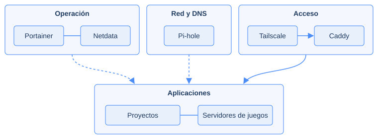
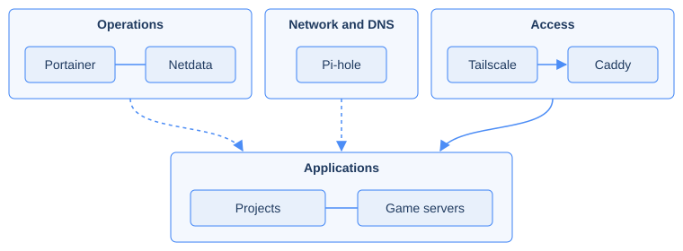

<a href="#español"><b>Español</b></a> &nbsp;·&nbsp; <a href="#english"><b>English</b></a>

 

## Español

Estudiante de Ingeniería Civil Informática · Universidad Finis Terrae 
<b>Busco:</b> desarrollo backend e infraestructura TI, con interés en DevOps y ciberseguridad · <b>Abierto a</b> práctica y trabajo

### Experiencia

- **Ayudante universitario** (2024 – presente): Programación, Programación Avanzada y Teoría de la Computación; 5 semestres consecutivos con cursos de 23 a 30 estudiantes.
- **Analista TI Trainee** (2022, media jornada): mantenimiento de infraestructura TI e instalación de equipos.

### Stack

| Área | Tecnologías |
| --- | --- |
| Lenguajes | Python · C++ · SQL |
| Backend | FastAPI · SQLAlchemy · Alembic · PostgreSQL · SQLite · Redis |
| Frontend | JavaScript · Next.js (prototipo) |
| Infraestructura | Linux (Debian) · Docker · Caddy · Tailscale · Pi-hole · Portainer · Netdata |
| Herramientas | Git · pytest |

### Proyectos

<table>
<tr>
<td width="33%" valign="top"><h4>Asistencia</h4>
App web para controlar asistencia a clases y faltas restantes.

<code>Python · FastAPI · PostgreSQL · pytest</code>

<i>Código privado, a solicitud</i>
</td>
<td width="33%" valign="top"><h4>cppaudit</h4>
Evaluador de proyectos C++ con informe PDF.

<code>FastAPI · Redis · Next.js · Stripe</code>

<i>Prototipo</i>
</td>
<td width="33%" valign="top"><h4>Homelab</h4>
Servidor propio con acceso remoto seguro.

<code>Docker · Caddy · Tailscale · Pi-hole</code>

<i>En uso</i>
</td>
</tr>
</table>

### Homelab

Servidor Debian con Docker, organizado por función:

Acceso remoto solo por Tailscale, sin abrir puertos en el router. Además de ser mi infraestructura de práctica, hospeda servidores de juegos para mis amigos.

---

## English

Civil Engineering in Computer Science student · Universidad Finis Terrae 
<b>Looking for:</b> backend development and IT infrastructure, with a growing interest in DevOps and cybersecurity · <b>Open to</b> internships and jobs

### Experience

- **University teaching assistant** (2024 – present): Programming, Advanced Programming and Theory of Computation; 5 consecutive semesters with classes of 23 to 30 students.
- **IT Analyst Trainee** (2022, part-time): IT infrastructure maintenance and equipment setup.

### Stack

| Area | Technologies |
| --- | --- |
| Languages | Python · C++ · SQL |
| Backend | FastAPI · SQLAlchemy · Alembic · PostgreSQL · SQLite · Redis |
| Frontend | JavaScript · Next.js (prototype) |
| Infrastructure | Linux (Debian) · Docker · Caddy · Tailscale · Pi-hole · Portainer · Netdata |
| Tools | Git · pytest |

### Projects

<table>
<tr>
<td width="33%" valign="top"><h4>Asistencia</h4>
Web app to track class attendance and remaining absences.

<code>Python · FastAPI · PostgreSQL · pytest</code>

<i>Private code, on request</i>
</td>
<td width="33%" valign="top"><h4>cppaudit</h4>
C++ project evaluator with PDF reports.

<code>FastAPI · Redis · Next.js · Stripe</code>

<i>Prototype</i>
</td>
<td width="33%" valign="top"><h4>Homelab</h4>
Self-hosted server with secure remote access.

<code>Docker · Caddy · Tailscale · Pi-hole</code>

<i>In use</i>
</td>
</tr>
</table>

### Homelab

Debian server running Docker, organized by function:

Remote access only through Tailscale, with no open router ports. Besides being my practice infrastructure, it hosts game servers for my friends.

 

